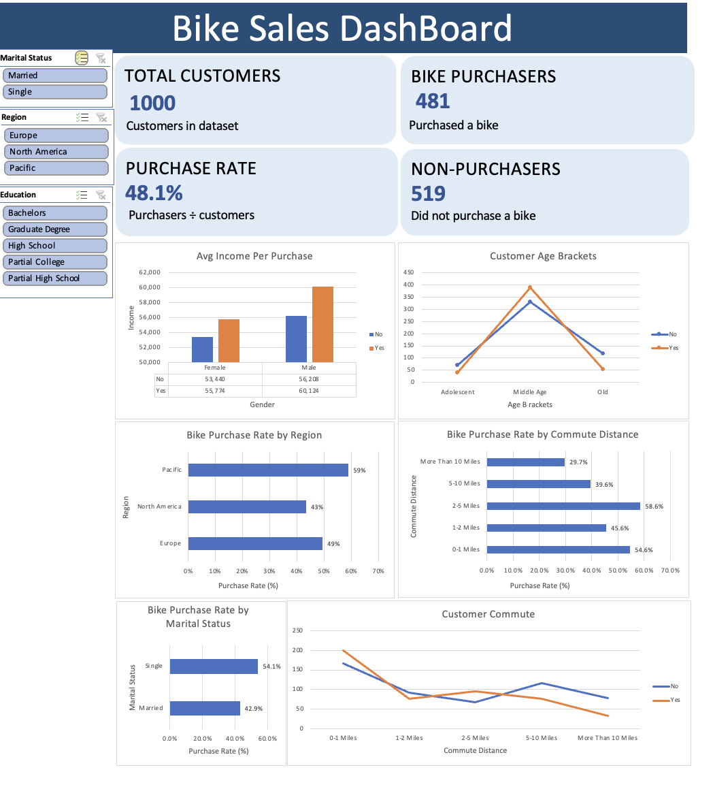

# Bike Sales Analysis — Excel Dashboard

## Project Overview
An Excel-based data analytics project exploring customer demographics and bike purchasing behaviour. The goal is to identify customer segments with higher bike purchase rates through data cleaning, PivotTables, PivotCharts, and an interactive dashboard.

## Dashboard Preview

## Tools Used
- Microsoft Excel
- Data cleaning and duplicate removal
- Excel formulas
- PivotTables and PivotCharts
- Slicers and dashboard visualisation

## Data Cleaning
- Original dataset: 1,026 records
- Duplicate records removed: 26
- Cleaned dataset: 1,000 records
- Standardised gender and marital-status labels
- Created age brackets for demographic analysis

## Key Performance Indicators

| KPI | Result |
|---|---:|
| Total customers | 1,000 |
| Bike purchasers | 481 |
| Non-purchasers | 519 |
| Purchase rate | 48.1% |

## Key Findings
- Overall bike purchase rate was 48.1%.
- The Pacific region had the highest purchase rate at approximately 58.9%.
- Single customers had a 54.1% purchase rate, compared with 42.9% for married customers.
- Customers commuting 2–5 miles had the highest purchase rate at 58.6%.
- Customers commuting more than 10 miles had the lowest purchase rate at 29.7%.
- Average income differed between customers who purchased bikes and those who did not.

## Interactive Dashboard
The dashboard contains six charts and slicers for:
- Marital status
- Region
- Education

The slicers let users filter the dashboard and explore different customer segments.

## Files
- `Bike_Sales_Excel_Project.xlsx` — Excel workbook containing the analysis and dashboard.
- `screenshots/Bike_sales_Dashboard.png` — Dashboard screenshot.
- `README.md` — Project documentation.

## Learning Outcomes
Practised data cleaning, PivotTables, PivotCharts, KPI calculations, and interactive dashboard development using Excel.

---
Project type: Data Analytics Learning Project
